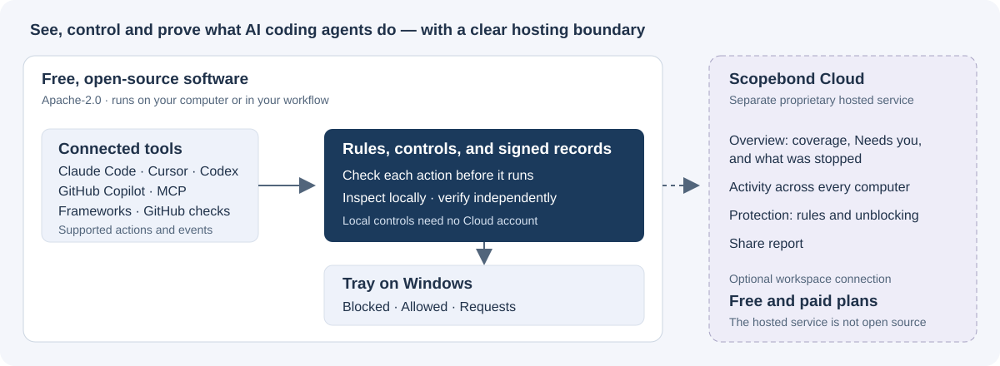

# Scopebond

[](LICENSE)
[](https://github.com/avouro-com/scopebond/actions/workflows/ci.yml)
[](https://www.npmjs.com/package/@scopebond/hook)

**See, control and prove what AI coding agents do on your computers.**

Scopebond checks each action a coding agent asks to take (a shell command, a file
read or write, a push, an MCP call) against your rules before it runs, and signs a
record of every decision that you can verify offline. It works with Claude Code,
Cursor, Codex, GitHub Copilot, MCP tools, agent frameworks and GitHub pull-request
checks.

[Get started](#get-started) ·
[Explore the sample workspace](https://cloud.scopebond.com/app/sample) ·
[Docs](https://scopebond.com/documentation)

## Get started

### Windows

[Create a free workspace](https://cloud.scopebond.com/app), press **Connect a
computer** and download the signed installer. Or run this in PowerShell:

```powershell
irm https://cloud.scopebond.com/install.ps1 | iex
```

The installer is signed by Avouro LLC, needs no Node.js and keeps itself updated. It
installs the Scopebond Agent (a companion program, not the AI coding agent doing the
work), the hook, and the Scopebond tray. On first start the agent signs the computer
in with a code you approve in the workspace and sets up the coding agents it finds.
See [Windows: the signed installer](packages/agent#windows-the-signed-installer) and
the [tray](packages/tray).

### macOS and Linux

```bash
npx -y @scopebond/agent@latest setup https://cloud.scopebond.com
```

`setup` needs Node.js 22.13 or later. It signs the computer in with a code you approve
in the workspace, adds the hook to Claude Code (add `--cursor` or `--codex` for those
tools), and starts the Scopebond Agent with your sign-in. On a Windows computer that
uses npm, type `npx.cmd`; no execution-policy change is needed.

### GitHub Copilot, or the hook alone

Run this in your own terminal, outside the coding agent:

```bash
npx -y @scopebond/hook@latest login https://cloud.scopebond.com --copilot
```

It prints a short code and an approval link for the workspace owner. Leave out
`--copilot` to connect Claude Code, or use `--cursor` or `--codex`. For Codex, review
Scopebond in `/hooks`, choose **Trust**, and start a new task. See the
[hook README](packages/hook) for each tool's details.

### Local only, no account

```bash
npm install -g @scopebond/hook@latest
scopebond install
scopebond status
```

`install` configures Claude Code and detects Cursor, Codex and the GitHub Copilot CLI;
choose one with `--cursor`, `--codex` or `--copilot`. Records stay on this computer.
For one project's setup:

```bash
npx -y @scopebond/hook@latest init          # Claude Code; add --cursor, --codex or --copilot
npx -y @scopebond/hook@latest log           # inspect recent decisions
npx -y @scopebond/hook@latest verify        # check stored records offline
```

In unattended setup, pass `--yes` to `init` after reviewing the configuration you are
authorizing.

> **Open source and hosted.** Everything in this repository is free, Apache-2.0
> open-source software, and it works without an account: the engine that checks and
> records every action, the starter protections, your own rules, and offline
> verification. Scopebond Cloud is a separate proprietary service with Free and paid
> plans. It adds curated rule packs that are kept up to date, Safe Install checks on
> the packages and downloads your agents install, one set of rules for every computer,
> approvals, inventory, and history for audits. Connecting one to the other changes
> the licence of neither.

## How it works

- **Every action is checked before it runs.** The hook on the computer checks each
  action the coding agent routes through its tools against your rules, and decides
  there, without waiting for the workspace.
- **Each rule is Watch, Needs approval or Block.** In a workspace a rule is set for
  everyone, for one agent, or for a group of agents. *Watch* records the action,
  *Needs approval* stops it until it is unblocked, and *Block* stops it. Changing
  Scopebond's own settings is always blocked, so a coding agent cannot switch
  Scopebond off.
- **Without an account,** each rule records (the default) or blocks. `scopebond rules`
  lists them in plain words, `scopebond rules enforce <rule>` makes one block, and
  `scopebond rules monitor <rule>` sets it back to recording. The starter rules cover
  release branches, destructive programs, and secret, build and guardrail settings;
  network and MCP calls are recorded so you can decide which limits to apply.
- **Every decision is a signed record.** Read them with `scopebond log` and check them
  offline with `scopebond verify`.

## When something is blocked

- On Windows, the tray shows it under **Blocked · Allowed · Requests**, in plain words,
  with the rule that stopped it. On macOS and Linux, and on Windows npm installs, the
  Scopebond Agent asks in its own window.
- What happens next follows the workspace's **Who approves unblocking** setting: *An
  admin* (the person asks to unblock it, with a reason, and an admin decides);
  *Automatic, reviewed later* (it is unblocked at once, for a length the workspace
  sets, and an admin reviews it later); or *People unblock their own* (the person
  unblocks it with a reason). A rule set to Block, and Scopebond's own protection,
  cannot be unblocked.
- Every unblock is recorded and shown in the workspace's **Activity**. Scopebond
  never runs the action itself; the person or the coding agent runs it again.
- Without an account, the coding agent is told which rule stopped it, and
  `scopebond rules` changes what blocks.

## The hosted workspace

Scopebond Cloud is a separate, proprietary service that brings every connected
computer into one place:

- **Overview**: coverage (which computers are protected), what **Needs you** (requests
  to unblock, findings, rule reviews), and what was **Stopped**.
- **Activity**: every action and decision from every connected computer, unblocks
  included.
- **Protection**: the rules, for everyone, one agent or a group, and who approves
  unblocking.
- **Share report**: a summary for a period, as a share link or a PDF.

| The question | The open-source software | What the hosted workspace adds |
|---|---|---|
| **What did an agent do?** | Signed local records of supported actions and decisions. | **Activity** across every computer, and coverage on the **Overview**. |
| **How are harmful actions stopped?** | Rules that record or block supported actions before they run, or before merge. | **Protection**: Watch · Needs approval · Block for everyone, one agent or a group, who approves unblocking, and confirmation of which computers loaded each rule. |
| **Can we prove it?** | Signed records you can verify offline, without an account. | Retained records, **Needs you**, and a **Share report**. |

See [workspace features](https://scopebond.com/hosted) and
[hosted plans](https://scopebond.com/pricing).



The hook decides without waiting for the workspace to receive records. An action
that needs approval still needs it: an unreachable workspace never grants
permission. Without a workspace connection, records stay on the computer. Connected
components send their records and health signals to the workspace.

## Packages

| Package | Purpose |
|---|---|
| [`@scopebond/hook`](packages/hook) | Checks for Claude Code, Cursor, Codex and GitHub Copilot, signed local records, and an optional workspace connection. |
| [`@scopebond/agent`](packages/agent) | The Scopebond Agent: delivers records, keeps the connection and the hook working, and asks a person about a blocked action. Distinct from the AI coding agent doing the work. |
| [`@scopebond/github-action`](packages/github-action) | Required agent pull-request checks in your own runner. |
| [`@scopebond/mcp`](packages/mcp) | A policy-checking proxy for MCP tool calls. |
| [`@scopebond/framework`](packages/framework) | Policy guards for tools inside agent applications. |
| [`@scopebond/gateway`](packages/gateway) | HTTP/MCP policy evaluation, constrained execution, signed evidence, and a kill switch. Default execution is a simulation. |
| [`@scopebond/verify`](packages/verify) | Deterministic policy evaluation, signature verification, and conformance vectors. |
| [`@scopebond/policy-schema`](packages/policy-schema) | Policy, action, receipt, and observation schemas and shared vectors. |
| [`@scopebond/sdk`](packages/sdk) | Signing action intents and approvals and submitting them to a gateway. |
| [`native`](packages/native) | The signed single executable for Windows: the Scopebond Agent and the hook in one program, and its installer. Windows program, not on npm. |
| [`tray`](packages/tray) | The Scopebond tray for Windows, a Tauri program. Windows program, not on npm. |

All of them are free to use and self-host under Apache-2.0. Not included, because they
are part of Scopebond Cloud: the curated rule packs, Safe Install checks, the hosted
portal, rules managed across many computers, approvals, inventory, shared retention
and evidence, administration, the API and billing.

## Coverage and limits

### Supported tools

| Connection | What it checks | Important limit |
|---|---|---|
| [Claude Code, Cursor, and Codex hook](packages/hook) | Supported tool actions delivered through the configured hook. | Cursor file edits are recorded **after** writing, not prevented. Codex file reads are checked when derived from supported shell commands; reads outside that path are not seen. |
| [GitHub Copilot hook](packages/hook#github-copilot) | Shell commands, file reads and edits, and git pushes, checked before they run. The Copilot CLI is covered; VS Code agent mode and the Copilot cloud agent are handled, with verification on live sessions in progress. | Cooperative: prevents if honored, but **a hook timeout fails open in Copilot**, so the hook denies on its own shorter deadline. MCP tool calls are recorded, not evaluated. |
| [GitHub Action](packages/github-action) | Policy checks on supported agent pull requests in your own runner. | Make the check required to gate merge. It does not monitor the agent's cloud sandbox; bypass rights remain outside the gate. Signing needs your configured signing key. |
| [MCP proxy](packages/mcp) | Each `tools/call` routed through the proxy before forwarding. | Resource reads and prompt fetches are outside the tool-call policy. |
| [Framework integrations](packages/framework) | Guarded tools in Vercel AI SDK, LangGraph/LangChain, or your own tool loop. | The application must honor the guard; calls outside it are not covered. |

### What to keep in mind

- **Coverage depends on the tool and the connection.** Only actions that reach a
  configured connection are checked; a process started outside the coding agent's
  tools is not covered. Some actions can be prevented; others are recorded after they
  happen. The [hook capability manifest](packages/hook#what-this-hook-can-honestly-claim-capabilities)
  separates unsupported, inactive, configured, degraded, and verified-reporting
  states: a configured hook or a received signal alone is not verified coverage.
- **Vendor tools are covered by rule packs.** What a cloud, Kubernetes, database,
  deployment or secret tool's command does, and what an MCP server's tool does, is read
  through signed rule packs from Scopebond Cloud. Without a pack, the hook checks shell
  commands, git pushes, file reads and writes, web requests, package installs and SQL
  run through `psql` and `sqlite3`, with the starter protections. See
  [rule packs](packages/hook#rule-packs).
- **A hook that cannot start fails open.** Coding agents treat a hook that cannot
  start as a non-blocking error and run the action unchecked. `scopebond status` and
  `scopebond doctor` report a hook entry that cannot start.
- **The packages are experimental.** Start with controlled test systems and review
  each package's coverage and operational limits before important work. Source
  availability is not a certification of production protection.
- **A signature proves less than it may seem.** It supports the integrity and
  provenance of what the signer asserted. By itself it does not prove an external
  effect, complete coverage, or regulatory compliance. See [SPEC.md](SPEC.md).
- **Future connections are not product capabilities.** Additional business-platform
  connections are ideas, not current features; see the
  [product roadmap](https://scopebond.com/roadmap).

## Verification and developer examples

[SPEC.md](SPEC.md) describes evidence, action types, verification, and what a
signature does and does not prove. Records omit file contents, prompts, and
secrets; read package-specific data and redaction details before connecting.

Initialize a self-hosted gateway:

```bash
npx -y @scopebond/gateway@latest init
```

```ts
import { createGateway, StaticPrincipalKeyRegistry } from "@scopebond/gateway";
const keys = new StaticPrincipalKeyRegistry(principalKeyRecords);
const { app, handleAction } = createGateway({ policy, authentication: { keys } });
```

See the [gateway README](packages/gateway) for simulation versus execution,
authentication, signing keys, and verification. Runnable examples live in
[`examples/`](examples/); they do not require the proprietary hosted workspace.
Existing policy and verification conformance vectors are available here.

## Releases

Current release set: `@scopebond/policy-schema@0.11.0`, `@scopebond/verify@0.6.10`,
`@scopebond/gateway@0.20.4`, `@scopebond/sdk@0.1.11`, `@scopebond/hook@0.30.0`,
`@scopebond/agent@0.11.3`, `@scopebond/github-action@0.5.17`, `@scopebond/mcp@2.0.18`,
and `@scopebond/framework@0.3.18`. Release tooling keeps these references in step
with package manifests. Public setup selects npm's latest published release;
generated hook configuration and managed workspace updates can pin versions
separately. The signed Windows programs are published on the
[releases page](https://github.com/avouro-com/scopebond/releases).

## Contributing and support

See [CONTRIBUTING.md](CONTRIBUTING.md), [SCOPE.md](SCOPE.md), and
[CODE_OF_CONDUCT.md](CODE_OF_CONDUCT.md); contributions are under a [CLA](CLA.md).
Report vulnerabilities privately as described in [SECURITY.md](SECURITY.md).
For hosted account or workspace help, use [Scopebond support](mailto:support@scopebond.com).

## License

The software here is Apache-2.0 — see [LICENSE](LICENSE) and [NOTICE](NOTICE).
This license does not cover the proprietary Scopebond Cloud service.
© 2026 Avouro LLC. Scopebond is a trademark of Avouro LLC.

Nothing in this repository is an offer of insurance, securities, or financial
services, or legal or financial advice.
